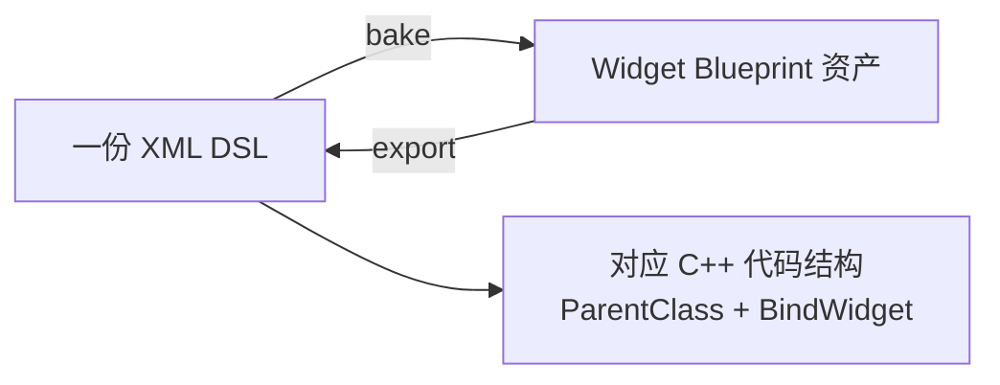
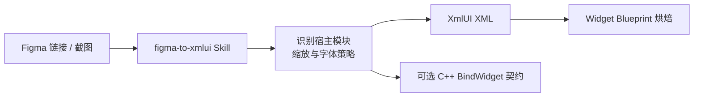

<p align="center">
  <picture>
    <source srcset="./Resources/Brand/xmlui-wordmark-dark.svg" media="(prefers-color-scheme: dark)">
    <source srcset="./Resources/Brand/xmlui-wordmark-light.svg" media="(prefers-color-scheme: light)">
    
  </picture>
</p>

<p align="center">一份 XML DSL，生成 Widget Blueprint 与对应的 C++ 代码结构。</p>

<p align="center">
  
  
  
  <a href="https://linux.do"></a>
</p>

<p align="center">
  <a href="./README.md">English</a> |
  <a href="./README_zh.md">简体中文</a>
</p>

---

### Overview

XmlUI 是一个跨项目的声明式 UI 插件：用一份 XML DSL 定义界面，在编辑器中一键烘焙出 Widget Blueprint 资产，并得到与之对应的 C++ 代码结构（`ParentClass` + `BindWidget`）。转换是双向的：烘焙（DSL→WBP）把 DSL 变成资产，导出（WBP→DSL）把资产变回 DSL，每个烘焙出的资产还内嵌源 DSL（`XmlUI.SourceDsl`）用于验证与增量更新。界面与代码同源，无需手工摆放控件或连线事件。



### Why XmlUI?

**为 AI 而生，精准而快速。** 主流方案让模型通过 Unreal MCP 编写 Python/Lua 编辑器脚本、逐节点驱动构建 UMG——链路长、执行慢、结果不稳定。XmlUI 的 DSL 是 AI-native 的声明式接口：界面即一段 XML，Agent 一次产出、无需调试脚本，烘焙出的 WBP 精确、可预期，生成效率成倍提升，让 AI 真正赋能 UMG 开发。

**一份 DSL，两种产出。** 同一份 XML 同时定义 WBP 布局与对应的 C++ 绑定结构，界面与代码始终一一对应、不会漂移；开发阶段还可直接用 XML 快速预览，无需等待烘焙。

**不绑定宿主工程。** 插件源码不依赖特定项目模块；模块名、API 宏、父类、设计分辨率、字体与源码目录，均由宿主工程自行决定。

**保留 Unreal 工作流。** WBP 进入常规的 UMG 与资产管理流程，C++ 侧继续使用 `BindWidget`、事件与运行时数据注入，与手写界面无异。

**内置 Figma 辅助链路。** 可选的 AI Skill 能将 Figma 节点或截图转换为 XmlUI 骨架，并生成适配宿主工程的 C++ 契约。

> [!TIP]
> XmlUI 仅依赖 Unreal Engine 模块。将源码插件复制到目标工程并重新编译后，原宿主的构建 ID、绝对路径与模块信息即被完全消除。

### Quick Start

**1. 安装源码插件**

将本目录复制到目标工程：

```text
<TargetProject>/Plugins/XmlUI/
```

源码分发包应包含 `XmlUI.uplugin`、`Source/`、`Config/`、`Resources/`、可选的 `AI/` 与文档。

> [!WARNING]
> 请勿跨项目复制 `Binaries/` 或 `Intermediate/`。其中包含原宿主与本机工具链生成的信息，应由目标工程重新生成。

**2. 重新生成并编译 Editor Target**

使用目标工程自身的 UE 工具链重新生成项目文件并编译。若宿主 C++ 模块使用了 XmlUI 类型，请在对应 `.Build.cs` 中添加依赖：

```csharp
PublicDependencyModuleNames.Add("XmlUI");
```

若仅在 `.cpp` 中使用 XmlUI，可改用 `PrivateDependencyModuleNames`；公开头文件暴露 XmlUI 类型时则应使用 Public 依赖。

**3. 编写 DSL**

```xml
<XmlUI Name="RewardCard">
    <Vertical Name="ContentColumn" Padding="16,12">
        <Text Name="TitleText" Text="礼包" ArtFontSize="26" Color="#FFFFFFFF" Justification="Center"/>
        <Spacer Name="SpaceTitleToBar" Size="12"/>
        <ProgressBar Name="RewardBar" Percent="0.6" FillColor="#FF00C853"/>
        <Spacer Name="SpaceBarToButton" Size="16"/>
        <Button Name="BtnClaim" Text="领取" ButtonColor="#FF263238" TextColor="#FFFFFFFF" HAlign="Center"/>
    </Vertical>
</XmlUI>
```

**4. 烘焙 Widget Blueprint**

Level Editor 主菜单 → **XmlUI** → **XmlUI: Bake DSL to Widget Blueprint**。

`RewardCard.xml` 默认烘焙为 `/Game/UI/WBP_RewardCard`。烘焙器不会覆盖同名资产；重新烘焙前请先删除旧资产或更换输出名称。

开发阶段如需快速预览，也可通过 `UXmlBuilder::BuildFromString` 在运行时直接构建界面：

```cpp
FString Error;
UWidget* Root = UXmlBuilder::BuildFromString(this, XmlContent, Error);
```

**5. 将 Widget Blueprint 导出回 DSL**

烘焙资产可往返：Level Editor 主菜单 → **XmlUI** → **XmlUI: Export WBP to DSL** 可将选中的 `.uasset` 导出回 `.xml`。

同样的操作也可通过控制台命令无头执行：

```text
XmlUI.ExportWbp Wbp=<资产路径> Out=<输出xml路径>
XmlUI.BakeDsl File=<xml路径>
```

`XmlUI.BakeDsl` 与烘焙菜单等价；`XmlUI.ExportWbp` 将 DSL 写回。

**6. 验证已保存的 Widget Blueprint 往返一致性**

在编辑器控制台运行（不要在 PIE 中运行）：

```text
XmlUI.ValidateRoundTrip Wbp=/Game/UI/WBP_ListEntry
```

XmlUI 会导出原始 WBP，生成并保存唯一命名的临时 WBP，重新从磁盘加载并比较两份导出的 XML 树。差异报告包含控件路径、属性和序列化数值；同时检查重新加载的编译模板中的文本字体。原始 WBP 不会被修改。运行前必须保存源 WBP。验证结束后会删除临时资产，清理失败时会记录准确路径。Unreal 删除资产时可能清除编辑器的撤销历史。此命令验证的是**可导出的 DSL 属性范围**，不覆盖动画、任意绑定或未导出的 UPROPERTY。


**7. 安全重建预览（不更改源 WBP）**

修改导出的 XML 后，在非 PIE 状态运行：

```text
XmlUI.RebakePreview Wbp=/Game/UI/WBP_ListEntry File=/absolute/path/ListEntry.xml
```

命令会生成、编译、保存并重新加载**临时候选 WBP**，比较现有 WBP 与候选的控件层次、名称、类、属性及原生 `Visual.*` 样式。如果已有 WBP 含有效的 `XmlUI.SourceDsl` 元数据，还会将上次的源 XML 单独重建，并与当前 WBP 比较，识别可能的手工修改。日志包含 `CHANGE`、`MANUAL-CONFLICT` 以及 `READY` / `CONFLICT` / `UNMANAGED` 状态。

本功能**仅预览**，不会修改源 WBP 或其 Blueprint 图表。临时资产会被删除，此过程可能清空编辑器 Undo 历史。`UNMANAGED` 表示无法可靠地检查冲突。当前尚不支持直接覆盖现有 WBP。


**为复制或未托管的 WBP 创建基线**

在编辑器中复制 WBP 可能丢失 `XmlUI.SourceDsl` 元数据。这时 `RebakePreview` 会报告 `UNMANAGED`，`RebakeApply` 拒绝更新。先保存复制的 WBP，然后明确确认将**当前**版本登记为新基线：

```text
XmlUI.AdoptBaseline Wbp=/Game/UI/WBP_ListEntry_ApplyTest Confirm=YES
```

命令先运行 `ValidateRoundTrip`，拒绝覆盖已有的基线元数据，单独备份 `.uasset`，再存储当前导出的 XML 和哈希。这是**主动确认**操作：无法检查登记前的人工修改，验证仅覆盖可导出的 DSL 内容，不包括 Blueprint 图表或动画。成功后重新运行 `RebakePreview`。现在 `UNMANAGED` 属于失败状态，不会被误认为 `READY`。

**8. 将属性和有限结构改动应用到现有 WBP（实验性）**

确认预览结果为 `READY`，退出 PIE 并保存 WBP 后运行：

```text
XmlUI.RebakeApply Wbp=/Game/UI/WBP_ListEntry File=/absolute/path/ListEntry.xml Confirm=YES
```

命令会重新执行预览和冲突检测，编译并重新加载临时候选 WBP。**属性模式**允许更改 `Text`、文本 `Color`、`FontSize` / `FontPath` / `Typeface`、`Visibility`、`RenderOpacity` 和支持的原生 `Visual.*`。**有限结构模式**支持在现有 `VerticalBox`、`HorizontalBox` 和 `Overlay` 内添加叶子节点 `Text`、`Image`、`Spacer`、调整顺序，以及在这些现有容器之间**移动已有的 Text/Image/Spacer 叶子控件**。保留原控件 UObject 和 GUID；未移动控件保留原插槽，移动控件使用从编译候选 WBP 复制的新目标插槽（允许 `Padding`、`HAlign`、`VAlign`、`SizeParam` 随目标改变）。预览会将移动显示为单个 `moved from ... to ...`，而不是删除和添加。现在可在一次 Apply 中混合结构更改和白名单属性更改（如 Text、Color、Font、Visibility、RenderOpacity、Visual.*）。根据稳定的 Name 匹配原有节点，预检查所有属性变化，保存 UObject/GUID。移动的叶子节点可以改变目标插槽；未移动节点的插槽修改仍禁止。现在可以实验性地**删除无引用的完整控件子树**，其根控件必须属于现有 Vertical/Horizontal/Overlay 容器，或是现有单内容容器 `UContentWidget`（例如 Button、Border、SizeBox）的唯一子控件，所有后代必须同时从目标 XML 中删除。预检查会逐个扫描 C++/BindWidget 属性、Blueprint 图表引用、UMG 设计器及动画绑定。每个删除的 UObject（包括嵌套容器）都会转移到临时包，然后删除对应 GUID，避免 UE5.8 编译器继续枚举旧控件。保留未删除控件的对象和 GUID。禁止删除仍被引用的节点、只删除子树的一部分、同一次操作将后代移出被删除的容器，以及重命名、非白名单属性更改、不支持的父容器及无有效基线的资产。

修改前 XmlUI 会把原始 `.uasset` 单独备份到 `Saved/XmlUIBackups/`。应用会保留原有资产路径、控件对象和 Blueprint 图表，重新编译后与临时候选的导出结果比对。失败时会从备份恢复完整 `.uasset` 文件，验证字节一致性，重新加载 WBP 并比较 XML、源元数据和 GUID 表。如恢复不完整，日志输出 `XmlUI rollback: INCOMPLETE`。进程崩溃或重载失败时仍可能需要手动从备份恢复。保存成功后更新 `XmlUI.SourceDsl` / `XmlUI.SourceHash`。最后清理临时资产，可能清空编辑器的 Undo 历史。此功能**仍属实验性**，请先在复制的测试 WBP 上验证；不支持 Blueprint 图表合并及移动有子节点的容器或子树；仅允许整体删除经过依赖检查的子树。结构操作会检查编译后的控件树。结构模式已在 SMA 的 UE5.8 中试运行，初次测试发现新加入的控件缺少变量 GUID，从而触发了编译器 handled ensure。现在 Apply 会在编译前为新控件登记 GUID，并修复旧版本留下的缺失 GUID，同时保持已有控件及动画 GUID 不变。结构新增与 GUID 处理、三个回滚注入点已在 UE5.8 验证；跨容器移动和回滚已通过 SMA 的 UE5.8 测试；叶子删除和依赖检查已在 SMA UE5.8 验证；**新的整体子树删除尚未在 UE5.8 编译测试**，请先在可丢弃的 WBP 上测试。


**测试安全删除叶子控件与子树（实验性）**

从已保存、有有效基线的可丢弃测试 WBP 导出 XML，删除现有 Vertical/Horizontal/Overlay 容器中的单个 `Text`、`Image` 或 `Spacer` 叶子节点，其余内容保持不变。预览应显示 `removed child` 和 `READY`；应用成功后日志应显示 `deleted=1`。重启编辑器并确认该节点与对应 GUID 已不存在，其他控件未变化。若该节点存在 C++/BindWidget、Blueprint 图表、UMG 属性绑定或动画引用，则 Apply 应报告明确的拒绝原因且不修改原 WBP。

这种检测只覆盖当前 WBP 内可识别的引用，**不能保证发现其他资产或 C++ 运行时字符串查找**；这些依赖必须人工核查。允许整体删除无引用的子树：从现有 Vertical/Horizontal/Overlay 容器中删除一个完整的嵌套 `<Vertical>` 或其他子树，也可从 Button/Border 等单内容容器中删除其唯一子节点，前提是候选容器完全变为空。所有后代必须同时消失。Preview 将在父容器上报告删除，成功 Apply 的 `deleted=N` 会计算所有被删除控件。重启编辑器后逐个检查后代和 GUID。禁止在同一次操作中将后代移出被删除的父容器。

**测试叶子控件跨容器移动**

从已保存、具有基线的 WBP 导出 XML。将现有 `<Text Name="..."/>` 从某个 `<Vertical>` 移到现有的 `<Overlay>` 或 `<Horizontal>`，保持控件名称、文本、类及所有非插槽属性不变。运行 `XmlUI.RebakePreview`，预期看到单条 `moved from ... to ...` 差异，且无手动冲突、状态为 `READY`。在可丢弃的测试 WBP 上用 `Confirm=YES` 应用，确认 `moved=1`，然后编译、保存、重启编辑器。移动时会重建目标容器的插槽，但原 UObject 和 GUID 应保留。

**在可丢弃的测试 WBP 上检查回滚（仅开发编辑器）**

准备一个仅新增叶子控件的 XML，确保预览结果为 `READY`，并有 `requestedChanges > 0` 和 `structureChanged=yes`。无差异的 XML 不允许注入失败。确认磁盘资产与备份逐字节一致后才会清除内存包的 dirty 标记以允许重新加载；如果重载失败，会重新标记为 dirty。分别执行下列命令，每次会故意报告 `FAILED`，成功恢复则同时输出 `XmlUI rollback: VERIFIED`：

```text
XmlUI.RebakeApply Wbp=/Game/UI/WBP_RollbackTest File=/absolute/path/structural.xml Confirm=YES TestFailAt=AfterMutation
XmlUI.RebakeApply Wbp=/Game/UI/WBP_RollbackTest File=/absolute/path/structural.xml Confirm=YES TestFailAt=AfterCompile
XmlUI.RebakeApply Wbp=/Game/UI/WBP_RollbackTest File=/absolute/path/structural.xml Confirm=YES TestFailAt=AfterSave
```

最后一条模拟保存后的失败。每次验证新增控件没有留下，包括重启编辑器后。此参数仅在 `WITH_DEV_AUTOMATION_TESTS` 下可用。若输出 `INCOMPLETE`，请勿保存打开的 WBP，保留 `Saved/XmlUIBackups/` 中的备份。

烘焙出的 Widget Blueprint 资产带有 `XmlUI.SourceDsl`、`XmlUI.SourceHash`、`XmlUI.BakeVersion` 包元数据（源 DSL 原文 + MD5），为未来的增量更新提供基线。

### DSL Reference

**标签**

| 类别 | 标签 | 行为 |
|---|---|---|
| 根/线性容器 | `XmlUI`, `Vertical`, `Horizontal` | 构建 `UXmlPanel`；`XmlUI` 与 `Vertical` 为垂直方向 |
| 叠放容器 | `Overlay` | 构建 `UOverlay`，支持子槽对齐与边距 |
| 单内容容器 | `SizeBox`, `ScaleBox` | 固定/约束期望尺寸或缩放内容，仅使用第一个子节点 |
| 换行/等宽容器 | `WrapBox`, `Grid` | 构建 `UWrapBox`（换行行容器）与 `UUniformGridPanel`（等宽网格） |
| 滚动容器 | `ScrollBox` | 构建 `UScrollBox`，`Orientation` 设置滚动方向 |
| 绝对定位容器 | `Canvas` | 构建 `UCanvasPanel`；子槽使用 `Position`/`Size`/`Anchors`/`Alignment`/`ZOrder`/`AutoSize` |
| 弹出菜单锚点 | `MenuAnchor` | 构建 `UMenuAnchor`；`Menu` 引用弹出 Widget Blueprint；最多一个子节点 |
| 背景边框 | `Border` | 构建 `UBorder`，支持 `BrushColor`/`Padding`；最多一个子节点 |
| 嵌套控件引用 | `UserWidget` | 通过 `WBP` 引用另一个 Widget Blueprint；带 `SlotName` 的子节点会插入到嵌套控件的命名槽中 |
| 元素 | `Text`, `Image`, `Button` | 文本、图像/色块、按钮 |
| 辅助元素 | `Spacer`, `ProgressBar` | 间距与从左到右的进度条 |

**常用属性**

| 范围 | 属性 |
|---|---|
| 通用 | `Name`, `Visibility`, `RenderOpacity` |
| 文本 | `Text`, `FontSize`, `ArtFontSize`, `FontFamily`, `Color`, `Justification`, `WrapTextAt`, `ShadowColor`, `ShadowOffset` |
| 图像 | `Brush`, `Color`, `DesiredSize` |
| 按钮 | `Text`, `ButtonColor`, `TextColor`, `FontFamily`, `Padding` |
| 进度条 | `Percent`, `FillColor` |
| 滚动容器 | `Orientation` |
| 嵌套控件 | `WBP`, `Text`, `Color`, `ArtFontSize`, `Justification` |
| 线性槽 | `Padding`, `HAlign`, `VAlign`, `SizeParam` |

- 颜色支持 `#RRGGBB`、`#AARRGGBB` 与 `(R,G,B,A)` 三种写法；需要透明度时建议统一使用 `#AARRGGBB`。
- 原生 UMG 的字体、笔刷和交互状态可通过白名单中的 `Visual.<PropertyName>` 往返导入导出；详见 DSL 参考文档 `visual-styles.md`。
- Brush 资源需填写真实对象路径，例如 `Texture2D→/Game/UI/T_Icon.T_Icon`；在资产尚未导入前，可先用纯色占位。
- `ArtFontSize` 使用插件内置的 Figma 字号映射；不采用该映射的项目请自行换算，并改用 `FontSize`。
- `FontFamily` 是通用的字体族标识符，通过宿主在 `XmlUISettings.FontFamilyMap` 中的配置解析，键由宿主自定义；与 Figma 协作时通常约定用 Figma 字体族名（如 `PingFang SC`）作为键。未映射或加载失败的字体名回退到引擎默认字体并输出警告。映射值可写完整对象路径（`/Game/Fonts/PingFang.PingFang`）或短包路径；为保证导出往返精确匹配，建议使用完整对象路径。
- `Canvas`、`MenuAnchor`、`Border` 的属性列在上方标签行为中；完整属性集见 DSL Reference。

完整的行为与边界说明见 [XmlUI DSL Reference（英文）](./AI/figma-to-xmlui/skills/figma-to-xmlui/references/xmlui-dsl.md)。

### C++ Binding

根节点通过 `ParentClass` 绑定宿主 C++ 类；XML 中的每个 `Name` 对应 C++ 侧的一个 `BindWidget` 属性，两者必须一一对应。

示例 `SampleGame` 仅用于演示路径格式，实际使用时须替换为宿主模块与类名。

```xml
<XmlUI Name="ProfileCard" ParentClass="/Script/SampleGame.ProfileCardWidget">
    <Text Name="PlayerNameText" Text="Player" FontSize="24"/>
</XmlUI>
```

对应属性的名称与类型必须与 DSL 完全一致：

```cpp
UPROPERTY(meta = (BindWidget))
UXmlTextBlock* PlayerNameText = nullptr;
```

未指定 `ParentClass` 时，烘焙器将使用配置中的 `BaseWidgetClass`，因此纯蓝图工程同样可以只通过 XML 生成界面。

### Configuration

插件默认配置位于 `Config/DefaultXmlUI.ini`，宿主工程可在自己的 `Config/DefaultXmlUI.ini` 中覆盖同名配置节：
> [!NOTE] 从 XmlUI 0.1.0 升级：设置类已移入运行时模块，配置节现为 `[/Script/XmlUI.XmlUISettings]` —— 请将工程 `Config/DefaultXmlUI.ini` 中旧的 `[/Script/XmlUIEditor.XmlUISettings]` 节直接改名即可；键与默认值均不变。

```ini
[/Script/XmlUI.XmlUISettings]
BaseWidgetClass=/Script/UMG.UserWidget
XmlRootPath=
BakedBlueprintOutputPath=/Game/UI
```

| Key | 用途 | 默认值 |
|---|---|---|
| `BaseWidgetClass` | 烘焙 WBP 的默认父类 | `/Script/UMG.UserWidget` |
| `XmlRootPath` | XML 文件选择器的初始目录 | 空，回退到工程根目录 |
| `BakedBlueprintOutputPath` | Widget Blueprint 输出目录 | `/Game/UI` |
| `WidgetClassMap` | 将 DSL 标签映射到宿主控件类路径 | 空 |
| `FontFamilyMap` | 将字体族名（键由宿主自定义；与 Figma 协作时通常约定用 Figma 字体族名）映射到宿主字体资产路径 | 空 |

宿主工程可通过 `XmlUISettings.WidgetClassMap` 将任意 DSL 标签映射到自研控件类（如 `Text` → `USampleTextBlock`）；插件本身保持项目无关。

### AI-Assisted Workflow

`AI/figma-to-xmlui/` 提供了一个符合 Agent Skills 规范的 Figma 转换工作流，支持 Claude Code 与 OpenCode，并可直接接收截图输入。



在 Claude Code 中本地加载：

```powershell
claude --plugin-dir "Plugins/XmlUI/AI/figma-to-xmlui"
```

安装步骤、Figma MCP 与 Skill 的详细说明见 [Figma to XmlUI README](./AI/figma-to-xmlui/README.md)。

### File Structure

```text
XmlUI/
├── AI/figma-to-xmlui/             Figma MCP + Agent Skill 工作流
├── Config/DefaultXmlUI.ini        插件默认配置
├── Resources/Brand/               README 深浅主题 SVG wordmark
├── Source/XmlUI/                  Runtime：DSL 解析与界面控件
├── Source/XmlUIEditor/            Editor：设置与 Widget Blueprint 烘焙
├── XmlUI.uplugin                  插件描述与模块声明
├── README.md                      English（主）
└── README_zh.md                   简体中文
```

### Requirements

- Unreal Engine 5.8 已在 SMA 宿主项目中验证；其他版本需额外测试。
- 若需接入其他引擎版本，请在目标工程中重新编译并验证 API 兼容性。
- Figma AI 工作流为可选能力；核心功能不依赖 MCP。

<details>
<summary>已知限制与烘焙注意事项</summary>

- 目前尚无输入框、滑块、列表视图、渐变、圆角、模糊或动画等标签。
- 每个烘焙节点都必须拥有非空、合法且全局唯一的 `Name`。
- XML 生成说明应写在 `<XmlUI>` 根节点内部；根节点之前的注释可能导致 Unreal XML 解析失败。
- 根节点没有父槽，因此根上的 `Padding`、`HAlign`、`VAlign`、`SizeParam` 均不生效。
- 未知标签会被跳过，未知或格式错误的属性通常被忽略；因此烘焙成功并不代表布局完整。
- `Button`、`SizeBox` 和 `ScaleBox` 最多使用一个子节点，额外子节点会被忽略。

</details>

## 致谢

感谢 [LINUX DO](https://linux.do) 社区的支持与认可，并特别感谢社区用户 [@muchenhen](https://linux.do/u/muchenhen) 提供的思路。
